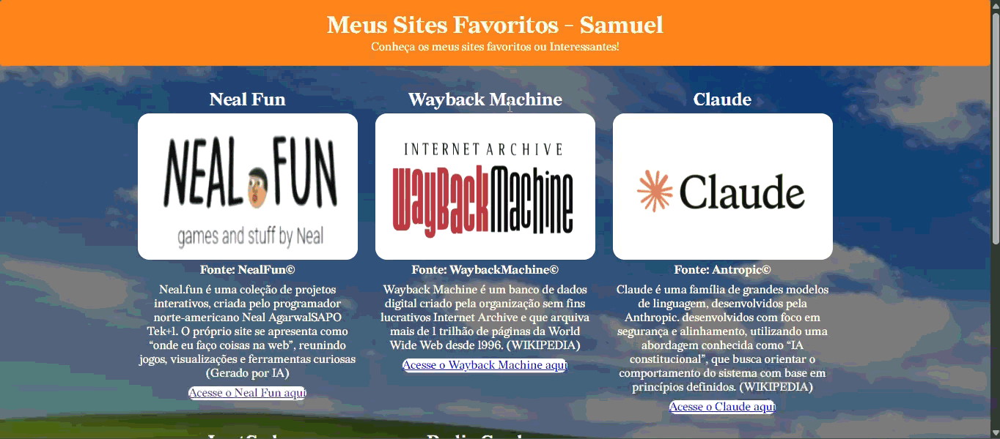

# 💻 Apresentação dos Sites Favoritos em HTML - Ag12 (ASFH)
👋 Seja Bem-Vindo! Este repositório têm como objetivo demonstrar a linguagem de marcação HTML com aplicações em CSS, apresentando sites interessantes a respeito em consideração.

## ‼️ Neste projeto você vai encontrar
  - 💻 Uso da HTML com sites interessantes
  - 📊 Aplicações básicas de CSS para organização de Sites

## ⚒️ As tecnologias utilizadas


## ⚙️ Pré-requisitos
Antes de instalar, certifique-se de ter instalado um **ambiente de desenvolvimento (ex. Vscode), extensões essenciais de manipulação/manipulação de [Python](https://www.python.org/) e extensões [Git](https://git-scm.com).**


## 🚀 Instalação e Execução
Para executar e instalar o código/programa, existem duas possibilidades clonando diretamente do repositório no github para IDE ou baixando o arquivo diretamente do github e executando na IDE.

### 1. Usando o terminal para clonar
```
// Clone este repositório pelo terminal 
$ git clone https://github.com/almedasamuel0-stack/Agenda05_DS
```
```
// Abra a pasta onde se encontra o código principal
$ cd projetos/consumo-energia
```
```
// Execute o Site
```
---
### 2. Baixando os Arquivos
  * Acesse a página principal do repositório no github;
  * Clique no *botão verde _CODE_*, localizado no lado direito, acima da lista de arquivos;
  * No menu suspenso, selecione a opção _Download ZIP_
  * Salve o arquivo e extraia a pasta para acessar todos os arquivos do projeto. 
---
### 3. Exemplo de execução!
<div align="center" alt="Gif" width="350" height="auto">
    <figure>
        
        <figcaption>Demonstração de Execução do Código</figcaption>
    </figure>
</div>

---